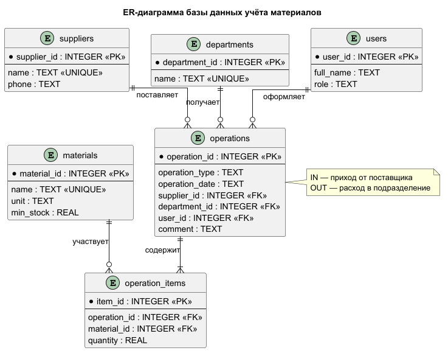

# Учёт прихода и расхода материалов

Учебный проект лабораторных работ №1–5. Приложение содержит модели `dataclass`, CRUD-репозитории, сервисный слой, авторизацию и консольный интерфейс с ролями. В ЛР5 добавлен экспорт операций и связанных материалов в JSON, CSV, XML и YAML.

## Назначение системы

Система хранит сведения о материалах на складе, поставщиках, подразделениях, пользователях и операциях движения материалов. Приход увеличивает остаток, расход уменьшает его. Остаток рассчитывается по истории операций, поэтому отдельное дублирующее поле остатка не требуется.

## Пользователи

| Роль | Основные действия |
| --- | --- |
| Кладовщик | Ведёт справочник материалов, оформляет приход и расход, контролирует складские остатки и историю операций. |
| Руководитель / бухгалтер | Просматривает остатки, историю движения и данные для отчётности. |

## Архитектура приложения

Приложение разделено на четыре слоя:

1. `models` — типизированные объекты предметной области;
2. `repositories` — SQL-запросы и CRUD для отдельных таблиц;
3. `services` — проверки, права доступа и бизнес-правила прихода/расхода;
4. `ui` — точка доступа к консольному меню, вводу пользователя и выводу сообщений.

Пользовательский интерфейс не обращается к SQLite напрямую. Сервисы используют репозитории, а репозитории преобразуют строки базы данных в объекты моделей. Схема взаимодействия сохранена в [`docs/diagrams/lab4_architecture.puml`](docs/diagrams/lab4_architecture.puml).

## ER-диаграмма

Исходный текст диаграммы находится в [`diagrams/materials_er.puml`](diagrams/materials_er.puml), изображение сохранено в [`diagrams/materials_er.png`](diagrams/materials_er.png).



В базе используются следующие сущности:

- `materials` — справочник материалов;
- `suppliers` — поставщики;
- `departments` — подразделения-получатели;
- `users` — пользователи и их роли;
- `operations` — заголовки операций прихода и расхода;
- `operation_items` — строки операций и связь операций с материалами.

Связь «многие-ко-многим» между операциями и материалами реализована промежуточной таблицей `operation_items`. Тип операции `IN` означает приход, `OUT` — расход.

## Структура проекта

```text
Учет прихода и расхода материалов/
├── README.md
├── database/
│   ├── schema.sql                  # структура таблиц и ограничения
│   ├── seed.sql                    # тестовые записи
│   ├── queries.sql                 # примеры запросов для отчётов
│   └── export_query.sql            # операции со связанными данными для ЛР5
├── data/
│   └── materials.db                 # создаётся при запуске
├── diagrams/
│   ├── materials_er.puml
│   └── materials_er.png
├── docs/
│   ├── diagrams/                    # материалы ЛР2
│   ├── lab5.md                      # описание и порядок сдачи ЛР5
│   └── run-results/
├── out/                             # результаты экспорта ЛР5
│   ├── data.json
│   ├── data.csv
│   ├── data.xml
│   └── data.yaml
├── src/export_data.py               # запуск экспорта из PyCharm
├── src/materials_app/
│   ├── database.py                   # подключение и инициализация SQLite
│   ├── exporter.py                   # группировка и сериализация данных
│   ├── models/                       # dataclass для всех таблиц
│   ├── repositories/                 # CRUD и SQL-запросы
│   ├── services/                     # бизнес-логика и авторизация
│   ├── ui/                           # публичная точка доступа к CLI
│   └── main.py
└── tests/
    ├── test_database.py
    ├── test_repositories.py
    ├── test_services.py
    ├── test_ui.py
    ├── test_exporter.py
    └── test_main.py
```

## SQL-схема и тестовые данные

Файл [`database/schema.sql`](database/schema.sql) создаёт структуру базы данных:

1. удаляет старые зависимые таблицы;
2. создаёт справочники и основные таблицы;
3. устанавливает первичные и внешние ключи;
4. добавляет ограничения `NOT NULL`, `UNIQUE` и `CHECK`;

Файл [`database/seed.sql`](database/seed.sql) заполняет таблицы тестовыми записями: материалами, поставщиками, подразделениями, пользователями и операциями прихода/расхода. Примеры отчётных запросов находятся в [`database/queries.sql`](database/queries.sql).

SQLite используется без отдельного сервера. Внешние ключи включаются в каждом соединении через `PRAGMA foreign_keys = ON`.

## Запуск

Требуется Python 3.10 или новее.

Для экспорта YAML и запуска всех тестов установите PyYAML в тот же интерпретатор Python, которым запускаете проект:

```bash
python -m pip install PyYAML
```

```bash
python -m src.materials_app.main
```

При первом запуске база `data/materials.db` создаётся по файлам `database/schema.sql` и `database/seed.sql`. Последующие запуски используют существующие данные и не перезаписывают их.

Демонстрационные пользователи:

| Логин | Пароль | Роль |
| --- | --- | --- |
| `ivanov` | `clerk123` | Кладовщик |
| `pupkin` | `accountant123` | Бухгалтер |

Пароли используются только для демонстрации лабораторной работы и хранятся в базе в виде PBKDF2-хэшей.

Кладовщик может добавлять материалы и оформлять приход/расход. Руководитель и бухгалтер могут просматривать остатки, историю и материалы ниже минимального запаса.

## Экспорт данных ЛР5

Из корня проекта выполните:

```bash
python src/export_data.py
```

В PyCharm можно открыть `src/export_data.py` и выбрать **Run**. Экспорт также доступен как модуль:

```bash
python -m src.materials_app.exporter
```

Программа создаёт папку `out` в корне проекта и записывает `data.json`, `data.csv`, `data.xml` и `data.yaml`. При повторном запуске эти четыре файла обновляются по текущим данным SQLite. Существующая база не пересоздаётся; при первом запуске без базы создаются стандартные демонстрационные данные. Явно заданная несуществующая база `--db` вызывает ошибку.

Пути можно указать отдельно:

```bash
python src/export_data.py --db data/materials.db --out out
```

В JSON, XML и YAML одна запись соответствует операции. Внутри находятся `supplier`, `department`, `user` и список `items` с вложенным `material`. В CSV одна строка соответствует позиции операции, поэтому реквизиты операции повторяются. CSV использует запятую, строку заголовков и UTF-8 с BOM для русских символов в табличных редакторах. Остальные файлы записаны в UTF-8.

Запрос находится в `database/export_query.sql`. Псевдонимы с `__` задают вложенность: `items__material__name` становится `items[].material.name`. Функции сериализации не зависят от полей таблицы; для другой структуры меняются SQL-запрос и ключи группировки. Подробнее: [описание ЛР5](docs/lab5.md).

## Проверка тестами

```bash
python -m unittest discover -s tests -v
```

Тесты проверяют наличие таблиц и тестовых записей, модели, CRUD-репозитории, расчёт остатков, авторизацию, роли, внешние ключи, бизнес-проверки и консольные сценарии. Проверки экспорта подтверждают совпадение содержимого JSON, XML и YAML, корректность CSV, обработку пустой базы и операций без позиций, сохранность исходной БД и обновление файлов при повторном запуске.

## Пример расчёта остатка

Для цемента в тестовых данных выполнены операции:

```text
приход: 100 кг
расход: 25 кг + 10 кг
остаток: 65 кг
```

## Связь с предыдущими лабораторными

Лабораторная работа №1 определила предметную область, роли пользователей и основные процессы. В лабораторной работе №2 проект был оформлен как Git-репозиторий с README и Use Case-диаграммой. В лабораторной работе №3 эти требования получили реляционную модель и слой данных SQLite. В лабораторной работе №4 слой данных был разделён на модели и репозитории, поверх них добавлены сервисы, авторизация и консольный пользовательский интерфейс. В лабораторной работе №5 реализован экспорт связанных данных в JSON, CSV, XML и YAML.

